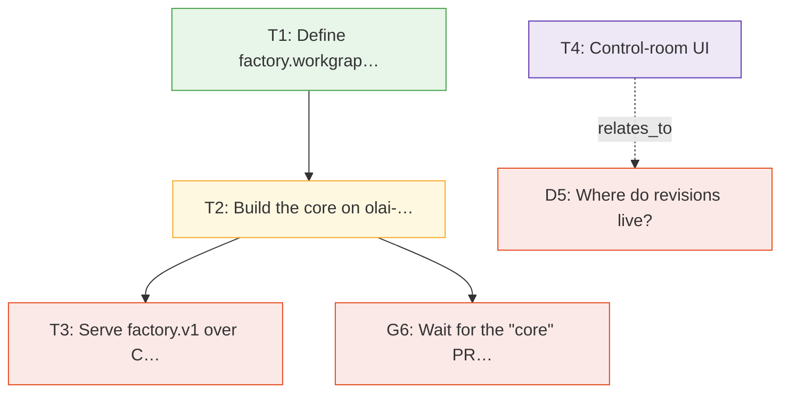

## Plan: Typed work graph on olai-store
ref `olai:019ab3c2-5b1e-7f00-8000-000000000000` · approved

**Goal:** An approved plan runs end to end on olai-store, with no GitHub issues.

**Rubric:**
- The conformance suite passes on every backend.
- Every revision names its actor.

**Budget:** $25.00

**Revision** `4be1d0c39a7f25e8b1c6d4f0a9e37b2c5d8f1a6e0b3c7d9e2f4a1b5c8d0e3f6a` · **approved** `a17c9e2d4f6b8a0c3e5d7f9b1a3c5e7d9f0b2a4c6e8d0f1a3b5c7e9d2f4a6b8c` · **drifted:** D5 (1 item since the approved revision)

**Items** (6)

| # | ref | kind | title | phase | conditions | blocked_by |
|---|---|---|---|---|---|---|
| T1 | `olai:019ab3c2-5b1e-7f00-8000-000000000001` | Task | Define factory.workgraph.v1 | done | – | – |
| T2 | `olai:019ab3c2-5b1e-7f00-8000-000000000002` | Task | Build the core on olai-store | approved | Ready | T1 |
| T3 | `olai:019ab3c2-5b1e-7f00-8000-000000000003` | Task | Serve factory.v1 over Connect | approved | Blocked | T2 |
| T4 | `olai:019ab3c2-5b1e-7f00-8000-000000000004` | Task | Control-room UI | approved | Running | – |
| D5 | `olai:019ab3c2-5b1e-7f00-8000-000000000005` | Decision | Where do revisions live? | proposed | Blocked | – |
| G6 | `olai:019ab3c2-5b1e-7f00-8000-000000000006` | Gate | Wait for the "core" PR [#12] \| merged | approved | Blocked | T2 |

**Other edges** (1)

- T4 `relates_to` D5
