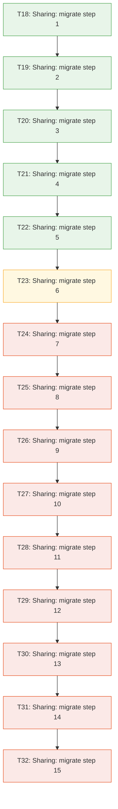

## T17: Sharing service (part of the plan Migrate every service to olai-store)
ref `olai:019ab3c2-5b1e-7f00-8000-000000000017` · Task approved · no conditions

**Revision** `4be1d0c39a7f25e8b1c6d4f0a9e37b2c5d8f1a6e0b3c7d9e2f4a1b5c8d0e3f6a` · **approved** `a17c9e2d4f6b8a0c3e5d7f9b1a3c5e7d9f0b2a4c6e8d0f1a3b5c7e9d2f4a6b8c`

**Items** (15)

| # | ref | kind | title | phase | conditions | blocked_by |
|---|---|---|---|---|---|---|
| T18 | `olai:019ab3c2-5b1e-7f00-8000-000000000018` | Task | Sharing: migrate step 1 | done | – | – |
| T19 | `olai:019ab3c2-5b1e-7f00-8000-000000000019` | Task | Sharing: migrate step 2 | done | – | T18 |
| T20 | `olai:019ab3c2-5b1e-7f00-8000-000000000020` | Task | Sharing: migrate step 3 | done | – | T19 |
| T21 | `olai:019ab3c2-5b1e-7f00-8000-000000000021` | Task | Sharing: migrate step 4 | done | – | T20 |
| T22 | `olai:019ab3c2-5b1e-7f00-8000-000000000022` | Task | Sharing: migrate step 5 | done | – | T21 |
| T23 | `olai:019ab3c2-5b1e-7f00-8000-000000000023` | Task | Sharing: migrate step 6 | approved | Ready | T22 |
| T24 | `olai:019ab3c2-5b1e-7f00-8000-000000000024` | Task | Sharing: migrate step 7 | approved | Blocked | T23 |
| T25 | `olai:019ab3c2-5b1e-7f00-8000-000000000025` | Task | Sharing: migrate step 8 | approved | Blocked | T24 |
| T26 | `olai:019ab3c2-5b1e-7f00-8000-000000000026` | Task | Sharing: migrate step 9 | approved | Blocked | T25 |
| T27 | `olai:019ab3c2-5b1e-7f00-8000-000000000027` | Task | Sharing: migrate step 10 | approved | Blocked | T26 |
| T28 | `olai:019ab3c2-5b1e-7f00-8000-000000000028` | Task | Sharing: migrate step 11 | approved | Blocked | T27 |
| T29 | `olai:019ab3c2-5b1e-7f00-8000-000000000029` | Task | Sharing: migrate step 12 | approved | Blocked | T28 |
| T30 | `olai:019ab3c2-5b1e-7f00-8000-000000000030` | Task | Sharing: migrate step 13 | approved | Blocked | T29 |
| T31 | `olai:019ab3c2-5b1e-7f00-8000-000000000031` | Task | Sharing: migrate step 14 | approved | Blocked | T30 |
| T32 | `olai:019ab3c2-5b1e-7f00-8000-000000000032` | Task | Sharing: migrate step 15 | approved | Blocked | T31 |
