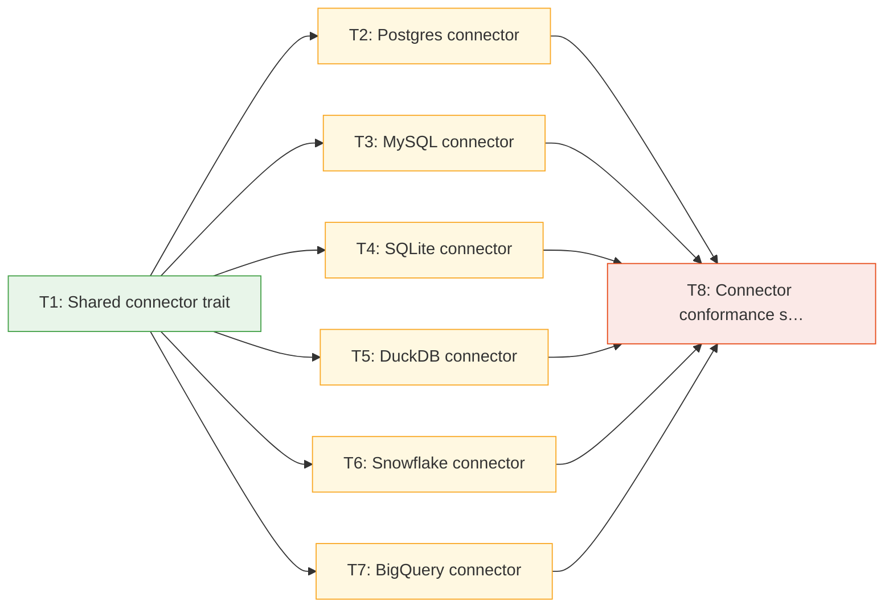

## Plan: Fan out the connectors
ref `olai:019ab3c2-5b1e-7f00-8000-000000000000` · approved

**Goal:** An approved plan runs end to end on olai-store, with no GitHub issues.

**Rubric:**
- The conformance suite passes on every backend.
- Every revision names its actor.

**Revision** `4be1d0c39a7f25e8b1c6d4f0a9e37b2c5d8f1a6e0b3c7d9e2f4a1b5c8d0e3f6a` · never approved

**Items** (8)

| # | ref | kind | title | phase | conditions | blocked_by |
|---|---|---|---|---|---|---|
| T1 | `olai:019ab3c2-5b1e-7f00-8000-000000000001` | Task | Shared connector trait | done | – | – |
| T2 | `olai:019ab3c2-5b1e-7f00-8000-000000000002` | Task | Postgres connector | approved | Ready | T1 |
| T3 | `olai:019ab3c2-5b1e-7f00-8000-000000000003` | Task | MySQL connector | approved | Ready | T1 |
| T4 | `olai:019ab3c2-5b1e-7f00-8000-000000000004` | Task | SQLite connector | approved | Ready | T1 |
| T5 | `olai:019ab3c2-5b1e-7f00-8000-000000000005` | Task | DuckDB connector | approved | Ready | T1 |
| T6 | `olai:019ab3c2-5b1e-7f00-8000-000000000006` | Task | Snowflake connector | approved | Ready | T1 |
| T7 | `olai:019ab3c2-5b1e-7f00-8000-000000000007` | Task | BigQuery connector | approved | Ready | T1 |
| T8 | `olai:019ab3c2-5b1e-7f00-8000-000000000008` | Task | Connector conformance suite | proposed | Blocked | T2, T3, T4, T5, T6, T7 |
